<a href="https://github.com/Harris-py">
  <picture>
    <source media="(prefers-color-scheme: dark)" srcset="dark_mode.svg">
    
  </picture>
</a>

### Featured: [agent-switchboard](https://github.com/Harris-py/agent-switchboard)

Run Claude Code and Codex as one team: shared context, usage-aware routing, failover and a local dashboard.

